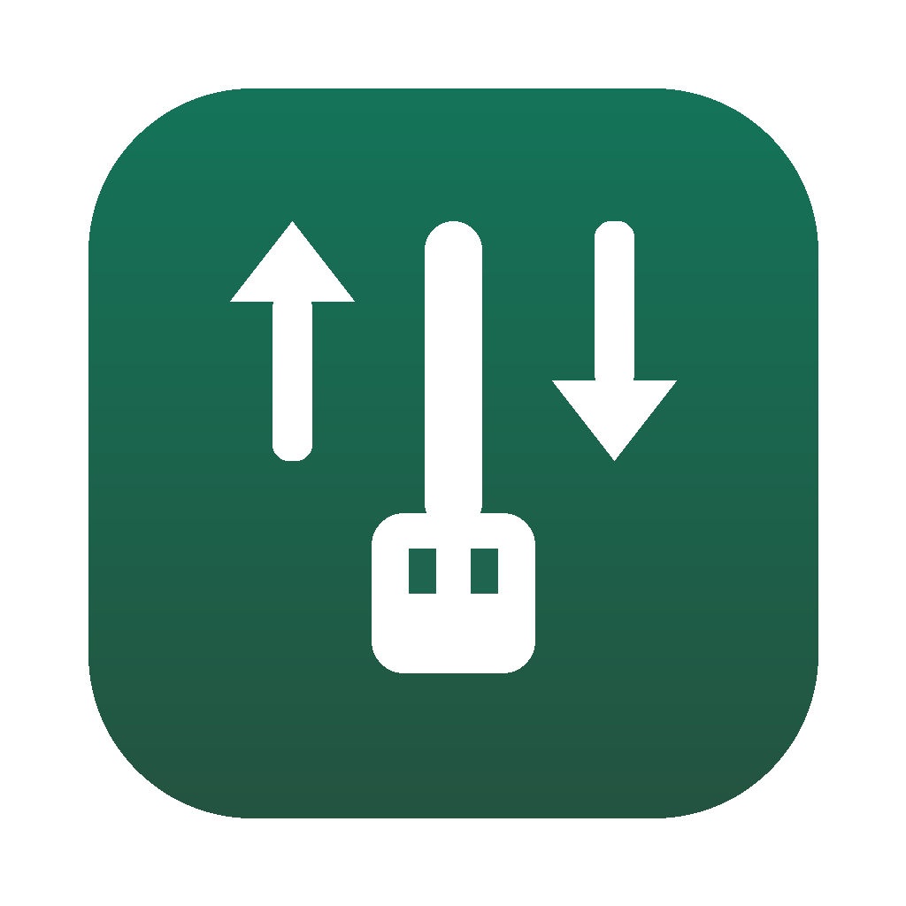
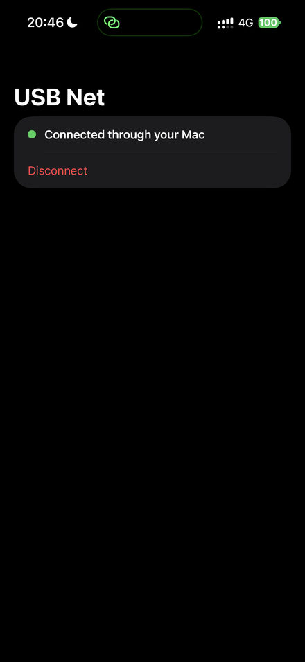
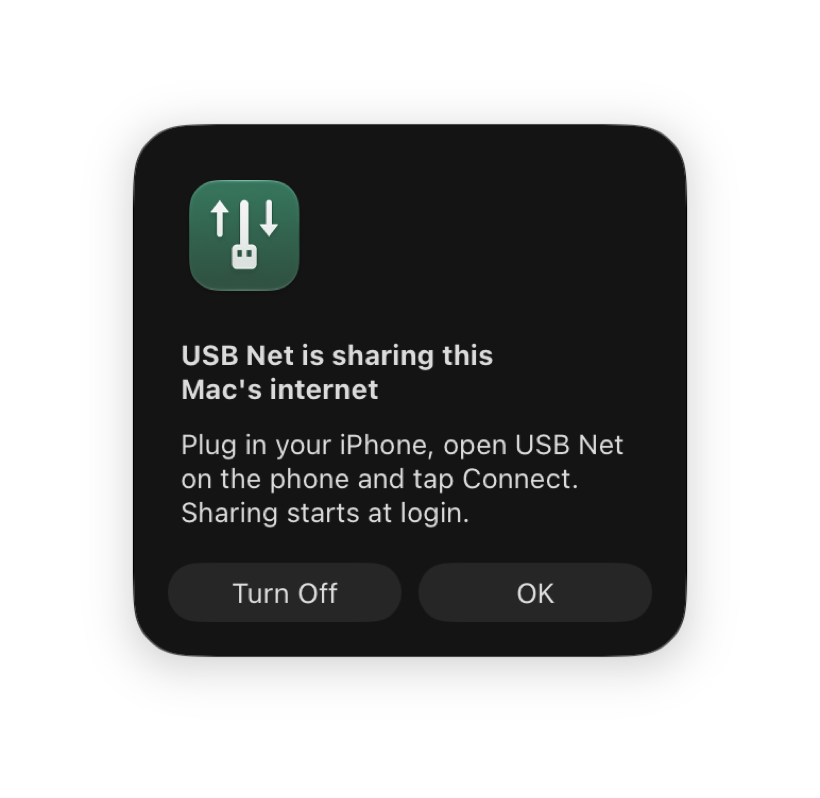
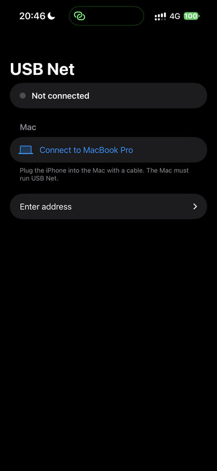

# USB Net



USB Net shares the internet connection of a Mac with an iPhone through a USB cable.

Use USB Net when the iPhone has a weak mobile signal and you cannot connect it to Wi-Fi. For example:

- The Wi-Fi network uses a company login (802.1X), so the iPhone cannot connect to it.
- macOS Internet Sharing does not operate, because the Mac uses a protected network.

USB Net does not change the network settings of the Mac. It does not need an administrator password.

| iPhone | Mac |
|---|---|
|  |  |

## How it operates

1. When you connect an iPhone to a Mac with a USB cable, macOS makes a private network on the cable. This network uses addresses in the range 169.254.x.x.
2. On the Mac, the USB Net service finds this network. It starts a web proxy on the address of the Mac on the cable.
3. The service tells the iPhone its address through Bonjour.
4. On the iPhone, the USB Net app finds the Mac. When you push **Connect**, the app sets a VPN profile. The VPN profile only sends web traffic (HTTP and HTTPS) from the iPhone to the proxy on the Mac.
5. The Mac sends the traffic to the internet through its own connection.

```
 iPhone apps ──► VPN profile (proxy only) ──► USB cable ──► USB Net on the Mac ──► internet
```

The proxy only accepts connections that come through the USB cable. Other computers on the network cannot use it.

## Limits

- USB Net sends web traffic (HTTP and HTTPS) only. Most apps use only web traffic. Apps that use other types of traffic (for example, some games and calls) continue to use the mobile connection.
- You must build the iPhone app with Xcode and your own Apple Developer account. The VPN feature needs the **Network Extension** capability, which a paid account gives.
- A development build of the iPhone app stops after its provisioning profile expires. Build it again to continue.

## Requirements

- A Mac with macOS 13 or later.
- Xcode 15 or later, and xcodegen (`brew install xcodegen`).
- Go 1.22 or later (`brew install go`).
- An iPhone with iOS 17 or later, and a USB cable.
- A paid Apple Developer account (for the iPhone app).

## Install on the Mac

1. Get the code:

   ```sh
   git clone https://github.com/xatuke/usbnet.git
   cd usbnet/mac
   ```

2. Build and install the app:

   ```sh
   make install
   ```

   This puts **USB Net.app** in `~/Applications` and starts the service. The service starts again each time you log in.

3. If macOS shows the message "USB Net can run in the background", this is correct. No action is necessary.

To see the status, double-click **USB Net** in `~/Applications`. The app shows a dialog. You can turn the service on or off in this dialog.

You can also see the service in **System Settings > General > Login Items & Extensions**. It shows as **USB Net**.

## Install on the iPhone

1. Connect the iPhone to the Mac with a USB cable. Unlock the iPhone. If the iPhone asks "Trust This Computer?", push **Trust**.
2. On the iPhone, turn on Developer Mode: **Settings > Privacy & Security > Developer Mode**.
3. Go to the `ios` folder and make your configuration file:

   ```sh
   cd usbnet/ios
   cp Local.example.xcconfig Local.xcconfig
   ```

4. Open `Local.xcconfig`. Set these two values:
   - `DEVELOPMENT_TEAM`: your team ID. Find it in Xcode, in **Settings > Accounts**.
   - `BUNDLE_ID_PREFIX`: a prefix that you own, for example `com.yourname`.
5. Build and install the app:

   ```sh
   ./install.sh
   ```

## Use

1. Connect the iPhone to the Mac with the USB cable.
2. On the iPhone, open **USB Net**.
3. The first time, the app asks for permission to find devices on the local network. Push **Allow**.
4. Push **Connect to** *(the name of your Mac)*.
5. The first time, iOS asks for permission to add a VPN configuration. Push **Allow**. Then enter your passcode.
6. The status changes to **Connected through your Mac**.

| 1. Find the Mac | 2. Connected |
|---|---|
|  |  |

To stop, push **Disconnect**. You can also turn off the VPN in **Settings > VPN**.

If you disconnect the cable, the app stops after approximately 15 seconds. The iPhone then uses its usual connection again.

If the Mac does not show in the app, push **Enter address** and type the address manually. To find the address, run this command on the Mac:

```sh
~/Applications/USB\ Net.app/Contents/MacOS/usbnet status
```

## Remove

On the Mac:

```sh
cd usbnet/mac
make uninstall
```

On the iPhone, delete the **USB Net** app. iOS also removes its VPN configuration.

## Problems

| Problem | Cause | Action |
|---|---|---|
| The app shows "Looking for a Mac on the USB cable" for a long time. | The service on the Mac does not operate, or the cable does not carry data. | Double-click **USB Net** on the Mac and make sure that it is on. Use a cable that carries data. Unlock the iPhone. |
| The status is "Connected", but pages do not open. | The address of the Mac changed (for example, you connected the cable again). | Push **Disconnect**, then push **Connect** again. |
| `make install` shows an error about `codesign`. | Xcode command line tools are not installed. | Run `xcode-select --install`. |
| `./install.sh` shows "No iPhone found". | The iPhone is locked, or it does not trust the Mac. | Unlock the iPhone. Push **Trust** if the iPhone asks. |

The log of the service is in `~/Library/Logs/usbnet.log`.

## Files

| Path | Contents |
|---|---|
| `mac/main.go` | The proxy and the Bonjour advertisement (Go). |
| `mac/Launcher.swift` | The **USB Net** app. It registers the service with `SMAppService`. |
| `mac/agent.plist` | The launch agent that runs the proxy at login. |
| `ios/App` | The iPhone app (SwiftUI). |
| `ios/Tunnel` | The VPN extension. It sets the proxy and stops when the Mac does not answer. |

## License

MIT. See [LICENSE](LICENSE).
